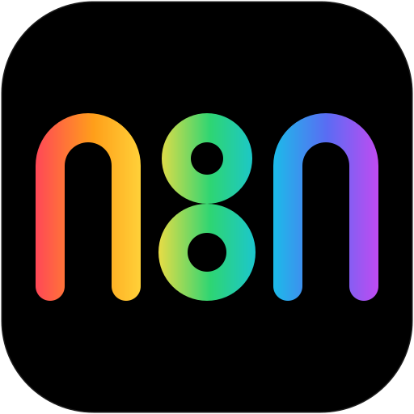

<div align="center">

# dsh-n8n-plugin

<p align="center"><strong>把 n8n 工作流运维，装进 DeepSeek Harness。</strong><br>实例登记一次，设置页与 Agent 随处可用。</p>

<p align="center">
  <a href="https://github.com/lchqi1998/dsh-n8n-plugin"></a>
  <a href="https://github.com/lchqi1998/dsh-n8n-plugin/graphs/contributors"></a>
  <a href="https://www.npmjs.com/package/dsh-n8n-plugin"></a>
  <a href="https://npmmirror.com/package/dsh-n8n-plugin"></a>
  <a href="https://socket.dev/npm/package/dsh-n8n-plugin"></a>
  
  
  
  
  
</p>

[English](README.md) · 中文

</div>

---

<div align="center">
  
</div>

## ✨ 为什么选它

大多数 n8n 集成方式，是把实例地址和 API Key 反复粘进对话。本插件让 n8n 成为 DeepSeek Harness 的一等公民：一个设置页、一份实例清单、15 个共享它的 Agent 工具。

### 一个别名，直达任意环境
实例只需在 **设置 → n8n 实例** 登记一次——别名（`prod` / `staging` / `local`…）、实例地址、API Key。所有工具按别名指定目标实例，同一段指令可以指向任何环境，无需重复粘贴凭据。

### 一份清单，两个界面，零漂移
设置页与 Agent 工具读取**同一份存储**——你在界面上配置的，就是 Agent 看到的。职责划分也是刻意的：Agent 只能**读取**实例清单，永远不能新增或修改——API Key 不应通过对话传递。

### 先离线校验，再放心发布
`n8n_workflow_validate` 在发送前完整检查工作流文档——节点 id/name 唯一（connections 以名称为键）、连接目标真实存在、webhook 节点配有 `Respond to Webhook` 响应节点、建议设置 `settings.executionOrder`——全程不访问实例。

### 密钥不出本机
API Key 只存 `~/.dsh/dsh-n8n-plugin.json`（`0600`）。所有响应只回显末四位，设置页从不回传完整密钥。

### 跟得上 n8n 的版本差异
发布走新版 `POST /workflows/{id}/publish`，仅在 404 时回退旧版 `activate`；其余版本差异，一次 `n8n_api` 直达。

## 🧩 Agent 工具

15 个工具，全部按别名寻址：

| 工具 | 作用 |
| --- | --- |
| `n8n_instances` | 列出实例（别名、地址、掩码密钥、默认项）；Agent 不能创建/修改实例 |
| `n8n_workflows` | 列出工作流（active / name / tags 过滤，游标分页） |
| `n8n_workflow_get` | 读取完整工作流 JSON |
| `n8n_workflow_create` | 从 JSON 创建工作流，可立即发布 |
| `n8n_workflow_update` | 用完整文档更新工作流，可同时发布/取消发布 |
| `n8n_workflow_delete` | 删除工作流（会停止其触发器） |
| `n8n_workflow_publish` | 发布（activate）/ 取消发布（deactivate） |
| `n8n_workflow_validate` | 离线校验工作流 JSON，不访问实例 |
| `n8n_executions` | 列出执行记录（可按 workflowId / status 过滤） |
| `n8n_execution_get` | 读取单次执行的结构化视图：状态、耗时、逐节点结果与错误摘要 |
| `n8n_wait_execution` | 轮询等待一条执行记录结束（可设超时与轮询间隔） |
| `n8n_webhook_call` | 经 Webhook 触发器手动运行工作流，默认等待执行结束并返回逐节点结果 |
| `n8n_tags` | 列出标签及 id |
| `n8n_credentials` | 列出凭证名称与类型（不含密钥值） |
| `n8n_api` | 通用 `/api/v1` 请求（路径需以 `/` 开头） |

工作流 JSON 规范与常见模式见 [`knowledge/workflow-guide.md`](knowledge/workflow-guide.md)；`announceToAgent` 开启时，系统提示会给 Agent 该文件的绝对路径，供其按需 `read`。工具描述与用户可见文案为中文；工具名、参数名与 n8n 协议词汇（字段名、节点类型、状态枚举）有意保留英文。

## 🖥️ 实例管理

**设置 → n8n 实例 → 添加实例**：

| 字段 | 说明 |
| --- | --- |
| 别名 | 字母或数字开头，只能含字母、数字、`.`、`_`、`-`，最长 64 字符；作为所有工具的目标标识 |
| 实例地址 | `https://n8n.example.com`、`http://localhost:5678`，可带子路径；末尾 `/api/v1` 可省略（会被自动规范化） |
| API Key | n8n 里 **设置 → n8n API → 创建 API Key**；编辑时留空表示保持原值 |
| 说明 | 可选备注 |
| 默认 | 新工作流默认使用的实例；全局只有一个，删除默认实例后自动顺延 |

「测试」按钮当场调用 `GET /workflows?limit=1`，显示延迟——或给出确切的失败原因：连接拒绝、DNS、超时、证书、401。

所有实例数据保存在一个文件：

```
~/.dsh/dsh-n8n-plugin.json     # $DSH_HOME/dsh-n8n-plugin.json，文件 0600 / 目录 0700
```

写入是原子的（临时文件 + 改名）；文件损坏时隔离为 `.corrupt-<时间戳>`，不会拖垮插件。

## 🚀 快速开始

```sh
# 按包名安装（npm 或兼容的 registry）
dsh plugin --profile web add dsh-n8n-plugin

# 安装到 desktop profile（桌面版自带 CLI，`dsh` 不在 PATH 时用它）
dsh plugin --profile desktop add dsh-n8n-plugin

# 从本地 tarball 或源码目录安装（开发/内网）
dsh plugin --profile web add ./dsh-n8n-plugin-0.1.0.tgz
dsh plugin --profile web add link:<本包所在路径>
```

安装后**重启** `dsh web` 或桌面应用，设置页会出现「n8n 实例」分区。无需其他配置——只需一个启用了 API 的 n8n 实例和它的 API Key。

### 手动安装（不使用 `dsh plugin`）

1. 把包放到 `<DSH_HOME>/profiles/<profile>/node_modules/dsh-n8n-plugin`（`DSH_HOME` 默认 `~/.dsh`）——解压 tarball 或复制目录都可以。
2. 确保该 profile 的 `cordis.patch.yml` 里有：

   ```yaml
   - insert:
       - id: n8n
         name: 'dsh-n8n-plugin'
   ```

3. 重启应用。

包内的 `cordis.patch.yml` 是 bundle 补丁，只有把本包加入 `dsh.profile.bundles` 时才需要；直接插入 profile 补丁的方式更简单。

## ⚙️ 工作原理

标准的 DSH 双半边包：宿主半边（`lib/`）+ 浏览器半边（`client/index.js`，无构建步骤）。

```
设置页（浏览器）                                 Agent（模型）
  │                                              │
  ├─ GET/POST/PATCH/DELETE ───┐                  ├─ 15 个 n8n_* 工具
  │  /api/dsh-n8n-plugin/*    │                  │
  ▼                           ▼                  ▼
┌─────────── 回环围栏（仅 127.0.0.1 / ::1）─────────────────┐
│    lib/routes.js                        lib/tools.js     │
│            └───────────────┬─────────────┘               │
│                      lib/store.js        lib/n8n.js      │
│   ~/.dsh/dsh-n8n-plugin.json       n8n REST API v1       │
└───────────────────────────────────────────────────────────┘
```

- **宿主半边**——`lib/index.js` 在一个 `apply()` 里注册路由、15 个工具与可选提示段；`lib/store.js` 管理实例清单（原子写、`0600`、损坏隔离）；`lib/n8n.js` 是 API v1 客户端（30 秒超时、合并中止信号、`accept-encoding: identity`），外加 Webhook 直连调用与执行轮询等待；`lib/http.js` 落实回环围栏；`lib/mount-once.js` 保证同一 package/profile 只挂载一份。
- **浏览器半边**——`client/index.js` 渲染设置分区，走同一组路由，GUI 与 Agent 永远一致。
- **提示词引导**——`lib/guidance.js` 生成系统提示段；仅当会话中 n8n_* 工具可见时才渲染。

## ⚙️ 配置

两个布尔开关位于 profile 补丁中该插件的 `config`。两者都是 `volatile()`：修改后**无需重启**即生效——loader 广播变更，插件就地重新注册各界面。

```yaml
- id: n8n
  name: 'dsh-n8n-plugin'
  config:
    enabled: true          # 总开关：路由、工具、提示段
    announceToAgent: true  # 是否向 Agent 注入插件说明（默认开）
```

## 🛡️ 安全模型

- `/api/dsh-n8n-plugin/*` 仅接受**回环地址**请求，并校验 `Host`、`Origin`、`Sec-Fetch-Site`；带 `X-Forwarded-For` / `CF-Connecting-IP` 的请求一律拒绝（视为经过代理）。因此不要通过反向代理把该页面暴露到局域网。
- 请求体上限 256 KiB，响应一律 `no-store`。
- API Key 以明文保存在用户主目录私有文件（`0600`），与 `~/.n8n`、`n8n-api.sh` 的环境文件同一信任模型；接口响应只含末四位。
- Agent 只能读取实例清单，**不能**新增或修改实例——API Key 不应通过对话传递。
- n8n API Key 拥有该实例的完整 API 权限（按 n8n 的 key 作用域），请只登记可信实例，定期轮换，并优先为自动化单独建用户。
- 发布/取消发布会立即影响生产的 webhook 与定时触发器；删除工作流会停止其触发器；执行记录可能含业务敏感数据。插件的系统提示要求 Agent 在执行这些操作前先向用户确认。

## 🛠 开发

需要 Node.js `^22.19.0 || >=24`。

```sh
npm run check             # 语法检查（全部源文件）
```

目录：

```
lib/index.js             插件入口（Config、apply、路由/工具/提示段注册）
lib/store.js             实例存储（原子写、0600、损坏文件隔离）
lib/n8n.js               n8n 公开 API v1 客户端（含 webhook 直连与执行等待）
lib/routes.js            /api/dsh-n8n-plugin 路由（回环围栏）
lib/tool-specs.js        15 个 Agent 工具定义（参数、输出 schema、render、execute）
lib/tools.js             唯一的 defineTool() 适配层
lib/render.js            纯函数渲染器（供各 render 钩子复用）
lib/workflow-validate.js 离线工作流校验
lib/http.js              JSON 读写与回环围栏
lib/mount-once.js        单挂载守卫（同一 package/profile 只挂载一次）
lib/guidance.js          系统提示文本
client/index.js          浏览器半边（设置分区，无构建步骤）
knowledge/               工作流 JSON 参考
```

## 📦 发布

```sh
npm pack                 # 产出 dsh-n8n-plugin-0.1.0.tgz（lib/、client/、knowledge/、cordis.patch.yml、icon.svg 与两个 README）
npm publish              # 已登录 npm 时发布（未 scoped 包用默认 registry 即可）
```

> 包名同时出现在三处——`package.json`、`cordis.patch.yml` 的 cordis 行、`client/index.js` 的浏览器模块 id。若发布到自己的 scope，请三处同步修改。

## 🔐 权限与兼容

- **权限**：在 harness home（`~/.dsh` / `$DSH_HOME`）下写一个 JSON 文件；向已登记的 n8n 实例发起出站 HTTP(S) 请求；经宿主 web 服务提供仅回环可达的路由族。**不含**命令执行 / Shell。
- **兼容**：DSH `>= 0.2.1-rc.2`（同时写在 `engines.dsh` 与 `dsh.engines.dsh`）、Node.js `^22.19.0 || >=24`、n8n 公开 API v1（1.x 及以后；发布端点有新旧回退）。
- **生命周期**：无 `preinstall` / `install` / `postinstall` 脚本——装完即用。
- **依赖姿态**：唯一运行时依赖是 `@deepseek-ai/schemastery`；所有 `@deepseek-ai/dsh-*` 包与 `react` 均为可选 peerDependencies——本插件不重复安装、不替换、不遮蔽官方组件。

## 🤖 模型体验

- 15 个 `n8n_*` 工具（见上表）；`n8n_instances` 与 `n8n_workflow_validate` 是最安全的只读入口。
- 运行闭环：`n8n_workflow_publish` 发布 → `n8n_webhook_call` 触发并等待 → `n8n_execution_get` 复查，一条链路覆盖「部署、运行、验证」。
- 可选系统提示段（`announceToAgent`）：教 Agent 别名约定，并指向 `knowledge/workflow-guide.md` 获取完整工作流 JSON 规范。
- 破坏性操作（发布、删除）由提示段中的「先向用户确认」规则把关。

## ⚠️ 已知限制

- n8n 公开 API 仍没有跨版本稳定的「手动执行工作流」端点；`n8n_webhook_call` 通过 Webhook 触发器补上了这条路径——要求工作流里有 Webhook 节点且已发布（或用 `mode:"test"` 配合编辑器监听测试事件）。不含 Webhook 触发器的工作流，请在 n8n 界面执行，再用 `n8n_executions` / `n8n_execution_get` 查看结果。
- 不同 n8n 版本的公开 API 端点与字段有差异（例如 `publish/unpublish` 与 `activate/deactivate` 并存、更新可能需要 `versionId`）。插件对发布/取消发布做了 404 回退；其他差异可用 `n8n_api` 直达接口。
- 实例地址使用自签名证书时会被 DSH 主机的 TLS 校验拒绝（提示证书错误）；请为实例配置受信任证书，或使用内网 HTTP。
- 一个 profile 只挂载一份本插件（重复行会由内置的 single-instance 守卫去重）。

## 📄 许可证

[MIT](LICENSE)
